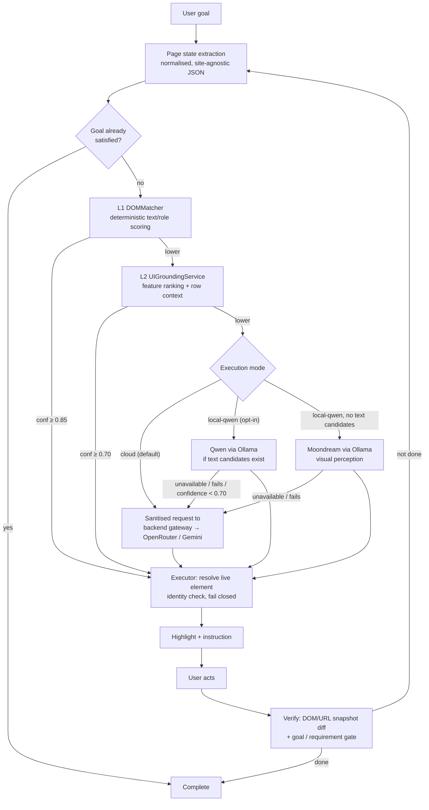

# ScreenPilot

A Chrome (Manifest V3) extension that **guides** a user through a web application toward a stated goal. It reads the live page, works out the single next action, highlights the exact control to use, waits for the user to perform it, checks what changed on the page, and repeats. It never clicks or types for the user.

> Status: working prototype under active development. See [Known limitations](#known-limitations) and [Roadmap](#roadmap) for what is and is not done.

## Problem

Complex web apps (admin consoles, settings trees, repository/CI tools) bury common tasks behind menus whose labels differ from the user's words. Chat assistants can describe the steps but can't see the live page; autonomous browser agents can see it but take irreversible actions on the user's behalf. ScreenPilot sits between the two: it sees the page and points, the human acts.

## How it differs from an LLM browser wrapper

| Basic wrapper | ScreenPilot |
|---|---|
| Sends every page/screenshot to a cloud model | Tries deterministic matching and a small local ranker first; a model is called only when those aren't confident |
| Model output is trusted | A model's chosen `elementId` is validated against the current page state; low-confidence answers are discarded |
| Acts autonomously | **Guide-only**: highlight + wait. Asserted in tests (`autonomousFill: false` for every sensitive type) |
| "Done" when the model says so | Completion is checked against the live page (goal contract, requirement tracking) before it is accepted |
| Duplicate labels → picks one | Duplicate controls are disambiguated by row context + ordinal; the executor **fails closed** rather than highlight an arbitrary match |
| Raw page text goes to the provider | PII/secrets are redacted or tokenised on-device first; screenshots are masked from DOM bounding boxes |

## Pipeline



Source of truth for thresholds and routing: `extension/services/decision-router.js`.

### Components

| Area | Files | Responsibility |
|---|---|---|
| Orchestration | `extension/v2-task.js` | Plan loop, state machine, stale-plan discard, completion gating |
| Page state | `extension/services/page-state-service.js`, `lib/compact-page-state.js` | Visible interactive elements as normalised JSON, incl. bbox and row `context` |
| L1 / L2 | `lib/dom-matcher.js`, `services/ui-grounding-service.js` | Exact/synonym matching; relevance ranking incl. row context |
| L3 | `providers/local-qwen-adapter.js`, `local-vision-adapter.js`, `vercel-backend-adapter.js` | Qwen / Moondream via Ollama (proxied through the service worker), or cloud |
| Privacy | `lib/pii-detector.js`, `pii-vault.js`, `privacy-sanitizer.js`, `sensitive-policy.js`, `sensitive-guard.js`, `providers/sanitizing-adapter.js` | Detection, redaction, placeholder vault, sensitive-field guidance |
| Execution | `services/executor-engine.js`, `lib/row-context.js` | Resolve the target on the live DOM, self-check, highlight, detect the user's action |
| Verification | `services/goal-verifier.js`, `lib/task-progress.js`, `services/session-store.js` | Goal contracts, requirement progress, session survival across navigation |
| Backend | `src/app/api/{plan,analyze,health}`, `src/server/*` | Next.js gateway: provider selection, fallback chain, rate limiting, validation |

## Answers to common reviewer questions

- **Extension ↔ backend:** the content script asks the service worker to `POST /api/plan` (or `/api/recover`, `/api/analyze`) on its behalf, with a per-install session id; the service worker alone decides the destination. Provider keys live only in the backend's environment; the extension holds none (BYOK was removed in `0feef8d`).
- **L1/L2 grounding:** L1 scores element text/role/region against the goal (with a small synonym table). L2 ranks remaining candidates by feature relevance. Both use only the page's own labels and structure, with no per-site rules. `docs/UI_GROUNDING_MODEL.md`, `docs/PAGE_STATE.md`.
- **When Qwen is used:** only when execution mode is `local-qwen` (popup checkbox) and L2 produced at least one text candidate. It receives a capped, ranked candidate list and returns one action; answers below confidence 0.70 (`QWEN_MIN_CONFIDENCE`) are treated as failures.
- **When vision is used:** `local-qwen` mode with *zero* viable text candidates (e.g. icon-only controls). Moondream returns only an `elementId` that is re-validated against the page state; otherwise it falls through to cloud, never to Qwen.
- **Cloud fallback:** the default mode is `cloud`. The backend uses OpenRouter if `OPENROUTER_API_KEY` is set, otherwise Gemini; a second provider is tried only if `FALLBACK_PROVIDER` is set. A failed or unusable local Qwen/Moondream result is retried once on the cloud path. Every cloud request passes through `SanitizingAdapter`, which fails closed.
- **Sensitive fields:** a fixed table (`sensitive-policy.js`), not a model, decides handling. Email/phone → reversible per-task placeholders; passwords, cards, JWTs, API keys → irreversible `[REDACTED]`. For a password/card/OTP field the on-screen text tells the user to enter it themselves; field values are never read, stored or logged by the guard.
- **Premature completion:** completion is accepted only if the live page satisfies the goal contract and tracked requirements of a compound goal; the planner's own "done" is re-verified, and `GoalVerifier` has been hardened against false positives (hidden elements, word-boundary matching). See `docs/GOAL_VERIFICATION.md`.
- **Verifying an action:** pre/post page snapshots (URL + DOM hash) are compared after the user acts; a plan computed on a page that has since changed is discarded as stale and replanned.
- **Duplicate elements:** page state records each control's row `context` and its ordinal among same-labelled controls. The executor re-derives both on the live DOM; if the evidence doesn't single out one element, it refuses to highlight (`identity UNRESOLVED`) instead of guessing.

## Tech stack

Chrome MV3 extension in plain ES modules bundled with esbuild · Next.js 15 / React 19 / TypeScript backend gateway · Ollama (Qwen `qwen2.5-coder:7b`, Moondream) for local inference · OpenRouter and Gemini as cloud providers · Node's built-in test runner · Playwright (real-browser tests and eval harness).

## Quick start

Full details, port list and troubleshooting: [docs/SETUP.md](docs/SETUP.md).

```bash
npm ci
cp .env.example .env.local        # add at least one provider key (backend only)
npm run build:ext                 # bundles into extension/dist (committed, but rebuild after edits)
npm run dev                       # backend on http://localhost:3000; check /api/health
```

To make the extension use your local backend: popup → Settings → Backend URL → `http://localhost:3000` (no rebuild needed). Blank = production default.

Load the extension: `chrome://extensions` → Developer mode → **Load unpacked** → select `extension/`.

For local inference: `ollama pull qwen2.5-coder:7b && ollama pull moondream`, then enable *Local AI* in the extension popup.

## Tests

```bash
npm run test:ext      # extension unit/integration tests (node --test)
npm run test:server   # backend route/router tests
npx tsc --noEmit      # type check
npm run build         # production build of the backend
npm run test:eval     # eval-harness unit tests
```

Results of the last full run are in [docs/SETUP.md](docs/SETUP.md#verified-state). Tests that guard specific properties: `sensitive-policy`, `sensitive-guard`, `sanitizing-adapter`, `privacy-e2e-integration` (privacy); `contextual-grounding`, `executor-identity-*` (duplicates); `requirement-progress`, `requirement-gate-completion` (completion); `local-qwen*` (local adapter); `backend-config` (backend URL); `logging-hygiene` (no diagnostics/raw output/keys in source or bundles). A pin test in `v2-task-*` fails if any protected file changes without a deliberate re-pin.

## Demo

A step-by-step, 2–3 minute walkthrough with expected behaviour and failure interpretation: [docs/DEMO.md](docs/DEMO.md).

## Known limitations

- **Backend URL:** configurable from the popup (Settings → Backend URL, stored in `chrome.storage.local`), defaulting to the production deployment. Planner requests go through the service worker, which makes a local backend work from https pages. Checked in an automated Chromium session; not checked on other platforms or in a manually driven Chrome.
- **Credential detection is pattern-based.** A password written in a goal is redacted when it follows an explicit phrase (`password: X`, `password is X`, `with/use/using/enter/type password X`, or any quoted value after "password"). A password stated in some other form, or in another language, is not recognised.
- **Default mode is cloud, not local.** Local Qwen/Moondream are opt-in and need Ollama plus several GB of model downloads (qwen2.5-coder:7b alone is ~4.7 GB).
- **Local inference is slow on CPU.** `docs/METRICS.md` (measured on one i7-13620H Windows machine, small sample) shows median Qwen inference ≈ 12.6 s and mean time-to-first-highlight ≈ 8 s. Older documents quoting 1.5–2.5 s were design targets, not measurements.
- **Measured visual accuracy is modest:** 20/26 (76.9%) on a 13-case synthetic benchmark; 61.5% without cloud. Small and synthetic. Not evidence of real-world accuracy.
- Single-step planning: one action per cycle, replanned after each.
- Chrome only; `<all_urls>` host permission; no Firefox/Safari support.
- Real-site behaviour has only been spot-checked during development on a limited set of sites; there is no systematic real-site benchmark. Sites that bot-block automated Chromium could not be automated.
- The eval harness (`eval:*`) targets Windows (WMI resource sampler). One benchmark page was lost and replaced, so the recorded numbers for that case predate the replacement (see `eval/README.md`).
- `npm run lint` covers `src/` (backend) only; the extension's plain JS is not linted. It enables the Next.js, react-hooks and typescript-eslint rules, but not the react, jsx-a11y or import rules the legacy preset had.
- Legacy V1 code paths (`content.js`, `background.js`, `vision-service.js`) still exist alongside the V2 orchestrator.

## Roadmap

| Item | Status |
|---|---|
| Deterministic L1 + L2 grounding, guide-only executor | Done |
| Privacy layer (PII detection, vault, sanitising adapter, screenshot masking) | Done |
| Local Qwen + Moondream tiers; cloud fallback gateway | Done |
| Row-context grounding and executor identity resolution (duplicate controls) | Done; unit-tested and checked in one automated browser run, not yet on a real logged-in site |
| Requirement-aware completion for compound goals | Done |
| Real-world task reliability (more sites, regression scenarios) | In progress |
| Faster local inference (prompt caching, warm model, smaller candidate sets) | In progress (partial: warm-up and prefix caching exist) |
| Configurable backend URL (popup setting, validated, planner requests via the service worker) | Done; checked in an automated browser session |
| Better page-state observation (shadow DOM, iframes) | Planned |
| Tighter DOM + visual reasoning integration | Planned |
| More reliable verification and planning budgets / error handling | Planned |
| Cross-browser support | Planned (an experimental `v3-cross-browser` branch exists; not merged) |

## Documentation map

| Start here | |
|---|---|
| [docs/SETUP.md](docs/SETUP.md) | Install, configure, backend URL, verified test/build state |
| [docs/DEMO.md](docs/DEMO.md) | Demo script, failure cases |
| [docs/SECURITY.md](docs/SECURITY.md) | Secrets, history exposure, privacy design |
| [ARCHITECTURE.md](ARCHITECTURE.md) | Decision cascade, components, safeguards |
| [docs/METRICS.md](docs/METRICS.md) / [eval/README.md](eval/README.md) | Measured results and how they were produced |

Component specs: [Decision router](docs/DECISION_ROUTER.md) · [Execution & verification](docs/EXECUTION_AND_VERIFICATION.md) · [Goal verification](docs/GOAL_VERIFICATION.md) · [Page state](docs/PAGE_STATE.md) · [UI grounding](docs/UI_GROUNDING_MODEL.md) · [Qwen planner](docs/QWEN_PLANNER.md) · [Final implementation notes](docs/SCREENPILOT_FINAL_DOCUMENTATION.md)

Development history (V1–V3 plans, changelogs, migration notes; may describe earlier implementations): [docs/archive/](docs/archive/README.md).

## Development notes

- Permanent engineering rules (generic behaviour, no site-specific code): [claude.md](claude.md).
- The code and tests are authoritative where any document disagrees.
- After editing anything under `extension/` that is bundled, run `npm run build:ext` and commit the updated `extension/dist`.
